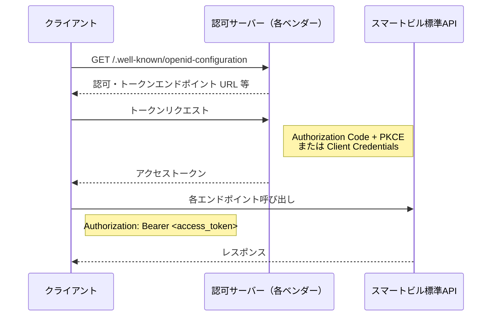
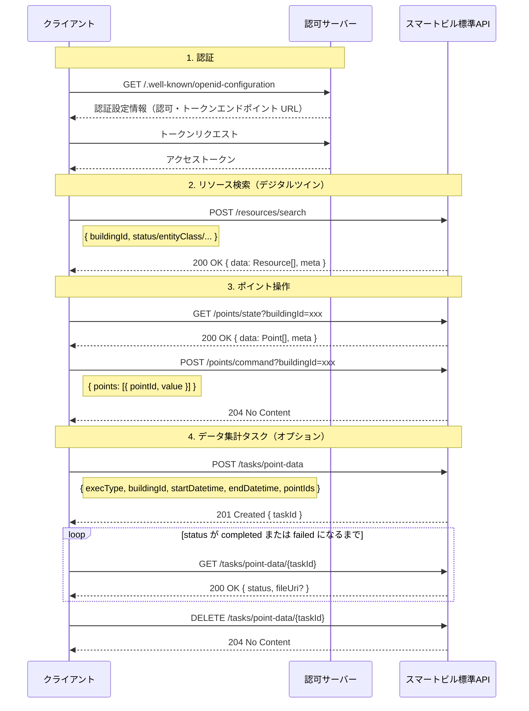
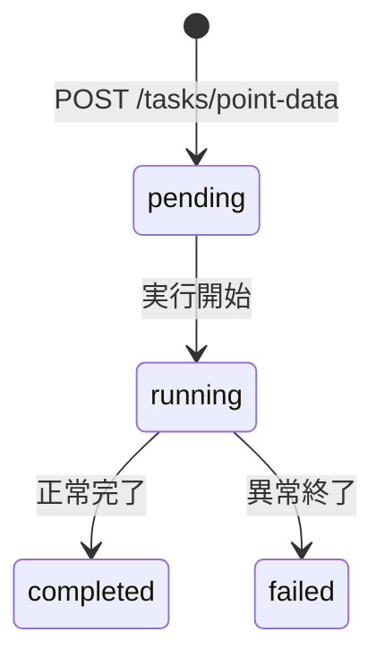

# スマートビル標準API

スマートビルディング共創機構（SBCO）の標準API / データモデル分科会が策定するAPI仕様を管理するリポジトリです。

アプリケーションやデバイスが通信するためのインターフェース定義（OpenAPI Specification）を収録しています。

データモデルの定義は [smartbuilding_datamodels](https://github.com/smartbuilding-co-creation-organization/smartbuilding_datamodels) リポジトリで別途管理されています。

## 設計原則

| 項目 | 内容 |
|---|---|
| プロトコル | HTTPS |
| データ形式 | JSON |
| 仕様形式 | OpenAPI 3.0 |
| 一覧レスポンス | `data` 配列 + `meta`（ページネーション情報）で統一 |
| エラーレスポンス | `code` / `message` / `details` / `timestamp` を持つ `Error` スキーマで統一 |
| 冪等性 | 変更系 POST は `Idempotency-Key` ヘッダに対応 |
| 共通ヘッダ | 成功レスポンスで `Request-Id` / `Date` を返却 |

## ベースURL

| 環境 | URL |
|---|---|
| 本番 | `https://api.example.com/v1` |
| ステージング | `https://api-staging.example.com/v1` |
| ローカル開発 | `http://localhost:3000/v1` |

認証には別ホストの認可サーバー（`https://auth.example.com`）を使用します。

## 認証

全エンドポイントで **OAuth 2.0 / OpenID Connect（OIDC）** による認証が必要です。
例外は OIDC Discovery のみで、認証不要で呼び出せます。

各ビルOS ベンダーは OIDC 準拠の認可サーバーを提供します。
クライアントは Discovery エンドポイントから認可・トークンエンドポイントの URL を自動取得します。

対応フロー:
- **Authorization Code + PKCE（S256）**: ユーザー操作を伴うアプリケーション向け
- **Client Credentials**: システム間連携（M2M）/ IoT デバイス向け

認証フローの詳細は [`components/security-schemes/oidc.yaml`](./components/security-schemes/oidc.yaml) を参照してください。

### 認証フロー



取得したアクセストークンはすべてのリクエストヘッダに付与します。

```http
Authorization: Bearer <access_token>
```

## APIエンドポイント一覧

| 分類 | メソッド | パス | 概要 | 認証 |
|---|---|---|---|---|
| Authentication | GET | `/.well-known/openid-configuration` | OIDC Discovery 情報取得 | 不要 |
| Resources | POST | `/resources/search` | リソース高度検索 | OIDC |
| Resources | PATCH | `/resources/{resourceId}` | リソース部分更新 | OIDC |
| Device Telemetry | GET | `/points/state` | ポイント状態一覧取得 | OIDC |
| Device Control | POST | `/points/command` | ポイント制御 | OIDC |
| Tasks | POST | `/tasks/point-data` | 即時実行タスク作成 | OIDC |
| Tasks | GET | `/tasks/point-data/{taskId}` | タスク状態・結果取得 | OIDC |
| Tasks | DELETE | `/tasks/point-data/{taskId}` | タスク削除 | OIDC |

## 標準的な利用順序

APIの標準的な呼び出し順序を示します。



## エンドポイント別 利用方法

### GET /.well-known/openid-configuration

OIDC 準拠の認可サーバーが提供する Discovery 情報を取得します。認証は不要です。
クライアントはこのエンドポイントから認可・トークンエンドポイントの URL を取得します。

**リクエスト**

```http
GET /.well-known/openid-configuration
```

**レスポンス（200）**: 認可エンドポイント・トークンエンドポイント・サポートスコープ等を含む JSON。

| ステータスコード | 意味 |
|---|---|
| 200 | 正常取得 |
| 400 | リクエスト不正 |
| 503 | サービス一時停止 |

---

### POST /resources/search

ビルディング内のリソース（デジタルツイン）を検索します。
`buildingId` はリクエストボディの必須フィールドです。

検索条件は以下の 2 種類の構造をサポートします。

**構造 A - シンプル検索（単一フィールド指定）**

フィールドは 1 つのみ指定します（複数指定不可）。

```json
{
  "buildingId": "building-a",
  "status": { "include": ["active"] }
}
```

```json
{
  "buildingId": "building-a",
  "entityClass": { "include": ["floor", "room"] }
}
```

**構造 B - 高度な検索（論理演算 filter）**

`filter.operator`（AND / OR / NOT / XOR）と `conditions` を組み合わせます。ネストも可能です。

```json
{
  "buildingId": "building-a",
  "filter": {
    "operator": "AND",
    "conditions": [
      { "field": "entityClass", "entityClass": { "include": ["floor"] } },
      { "field": "status",      "status":      { "include": ["active"] } }
    ]
  }
}
```

**レスポンス（200）**

```json
{
  "data": [
    {
      "id": "resource-001",
      "entityName": "1F 会議室A",
      "entityClass": "room",
      "buildingId": "building-a",
      "status": "active",
      "path": "building-a/floor-1/room-101"
    }
  ],
  "meta": { "total": 50, "page": 1, "pageSize": 20, "totalPages": 3 }
}
```

| ステータスコード | 意味 |
|---|---|
| 200 | 検索成功 |
| 400 | リクエスト不正 |
| 401 | 認証失敗 |
| 403 | 権限なし |
| 429 | レート制限超過 |
| 500 | サーバー内部エラー |
| 503 | サービス一時停止 |

---

### PATCH /resources/{resourceId}

指定したリソースを部分更新します。
`buildingId` はリクエストボディの必須フィールドです。指定しなかったフィールドは変更されません。

**リクエスト**

```http
PATCH /resources/{resourceId}
Content-Type: application/json
Authorization: Bearer <access_token>
```

```json
{
  "buildingId": "building-a",
  "status": "maintenance",
  "customTags": ["production", "maintenance-scheduled"]
}
```

**レスポンス（200）**: 更新後のリソース全体を返します。

| ステータスコード | 意味 |
|---|---|
| 200 | 更新成功 |
| 400 | リクエスト不正 |
| 401 | 認証失敗 |
| 403 | 権限なし |
| 404 | リソースが存在しない |
| 409 | 競合 |
| 429 | レート制限超過 |
| 500 | サーバー内部エラー |
| 503 | サービス一時停止 |

---

### GET /points/state

指定した敷地または建物配下のポイント一覧と現在状態を取得します。
`siteId` と `buildingId` はいずれか一方をクエリパラメータで指定します。

**クエリパラメータ**

| パラメータ | 型 | 必須 | 説明 |
|---|---|---|---|
| `siteId` | string | いずれか一方 | 対象敷地 ID |
| `buildingId` | string | いずれか一方 | 対象建物 ID |
| `pointId` | string[] | 任意 | 取得対象ポイント ID（複数指定可、省略時は全件） |
| `pageSize` | integer | 任意 | 1 ページあたりの件数（1〜100、既定 20） |
| `page` | integer | 任意 | ページ番号（既定 1） |

**リクエスト例**

```http
GET /points/state?buildingId=building-a&pageSize=50&page=1
Authorization: Bearer <access_token>
```

複数ポイントを絞り込む場合:

```http
GET /points/state?buildingId=building-a&pointId=VRV-1-POINT1&pointId=VRV-1-POINT2
Authorization: Bearer <access_token>
```

**レスポンス（200）**

```json
{
  "data": [
    {
      "pointId": "VRV-1-POINT1",
      "pointName": "VRV-1 運転モード",
      "pointType": "operationMode",
      "pointState": {
        "presentValue": "cool",
        "updatedAt": "2026-04-01T12:00:00Z"
      }
    }
  ],
  "meta": { "total": 100, "page": 1, "pageSize": 50, "totalPages": 2 }
}
```

| ステータスコード | 意味 |
|---|---|
| 200 | 正常取得 |
| 400 | リクエスト不正 |
| 403 | 権限なし |
| 404 | 指定リソースが存在しない |

---

### POST /points/command

指定した敷地または建物配下のポイントに値を設定します。
`siteId` と `buildingId` はいずれか一方をクエリパラメータで指定します。
成功時はレスポンスボディを返しません（204）。

**クエリパラメータ**

| パラメータ | 型 | 必須 | 説明 |
|---|---|---|---|
| `siteId` | string | いずれか一方 | 対象敷地 ID |
| `buildingId` | string | いずれか一方 | 対象建物 ID |

**リクエスト**

```http
POST /points/command?buildingId=building-a
Content-Type: application/json
Authorization: Bearer <access_token>
Idempotency-Key: <任意の一意文字列>
```

```json
{
  "points": [
    { "pointId": "point01", "value": "cool" },
    { "pointId": "point02", "value": 22 }
  ]
}
```

| ステータスコード | 意味 |
|---|---|
| 204 | 制御成功（レスポンスボディなし） |
| 400 | リクエスト不正 |
| 403 | 権限なし |
| 404 | 指定ポイントが存在しない |
| 409 | 同一 Idempotency-Key が処理中 |
| 422 | 同一 Idempotency-Key で内容が異なる |
| 500 | サーバー内部エラー |

---

### POST /tasks/point-data

指定期間・対象ポイントのデータ集計タスクを即時実行で作成します。
`siteId` と `buildingId` はリクエストボディでいずれか一方を指定します。

**リクエスト**

```http
POST /tasks/point-data
Content-Type: application/json
Authorization: Bearer <access_token>
Idempotency-Key: <任意の一意文字列>
```

```json
{
  "execType": "immediate",
  "buildingId": "building-001",
  "startDatetime": "2026-05-01T00:00:00Z",
  "endDatetime": "2026-05-01T23:59:59Z",
  "pointIds": ["1234567890", "1234567891"]
}
```

**レスポンス（201）**

```json
{
  "taskId": "task-abc123"
}
```

| ステータスコード | 意味 |
|---|---|
| 201 | タスク作成・実行開始 |
| 400 | リクエスト不正 |
| 401 | 認証失敗 |
| 403 | 権限なし |
| 409 | 同一 Idempotency-Key が処理中 |
| 422 | 同一 Idempotency-Key で内容が異なる |
| 429 | レート制限超過 |
| 500 | サーバー内部エラー |
| 503 | サービス一時停止 |

---

### GET /tasks/point-data/{taskId}

タスクの実行状況と結果を取得します。
`status` が `completed` の場合のみ、結果ファイルの `fileUri` が含まれます。

**パスパラメータ**

| パラメータ | 型 | 説明 |
|---|---|---|
| `taskId` | string | タスク ID（形式: `task-[a-zA-Z0-9]+`） |

**レスポンス（200）**

```json
{
  "taskId": "task-abc123",
  "execType": "immediate",
  "status": "completed",
  "startDatetime": "2026-05-01T00:00:00Z",
  "endDatetime": "2026-05-01T23:59:59Z",
  "pointIds": ["1234567890", "1234567891"],
  "fileUri": "https://storage.example.com/reports/task-abc123/report.csv",
  "createdAt": "2026-05-02T09:00:00Z"
}
```

**`status` の遷移**



| ステータスコード | 意味 |
|---|---|
| 200 | 取得成功 |
| 400 | リクエスト不正 |
| 401 | 認証失敗 |
| 403 | 権限なし |
| 404 | タスクが存在しない |
| 429 | レート制限超過 |
| 500 | サーバー内部エラー |
| 503 | サービス一時停止 |

---

### DELETE /tasks/point-data/{taskId}

タスクを削除します。メタデータ・スケジュール・出力ファイルをすべて削除します。
タスクが実行中の場合は 409 を返します。

| ステータスコード | 意味 |
|---|---|
| 204 | 削除成功（レスポンスボディなし） |
| 400 | リクエスト不正 |
| 401 | 認証失敗 |
| 403 | 権限なし |
| 404 | タスクが存在しない |
| 409 | タスクが実行中のため削除できない |
| 429 | レート制限超過 |
| 500 | サーバー内部エラー |
| 503 | サービス一時停止 |

---

## 共通仕様

### ページネーション

一覧系レスポンスは `data` 配列と `meta` オブジェクトで構成されます。

```json
{
  "data": [ ... ],
  "meta": {
    "total": 100,
    "page": 1,
    "pageSize": 20,
    "totalPages": 5
  }
}
```

### 冪等性（Idempotency-Key）

変更系 POST エンドポイント（`/points/command`・`/tasks/point-data`）は `Idempotency-Key` ヘッダに対応しています。

```http
Idempotency-Key: <クライアントが生成する一意な文字列>
```

| 状況 | 挙動 |
|---|---|
| 同一キー + 同一ペイロードの再送 | 最初の処理結果を返す（再実行しない） |
| 同一キー + 異なるペイロード | 422 |
| 同一キーの先行処理が進行中 | 409 |
| キーの保持期間 | 24 時間以上 |

### 共通レスポンスヘッダ

| ヘッダ | 説明 |
|---|---|
| `Request-Id` | リクエストのトレース識別子 |
| `Date` | レスポンス生成時刻（RFC 7231 形式） |

### エラーレスポンス形式

すべてのエラーレスポンスは以下のスキーマで返されます。

```json
{
  "code": "RESOURCE_NOT_FOUND（コード体系は各ビルOS提供会社の仕様に依存）",
  "message": "指定されたリソースが見つかりません（メッセージや詳細も各ビルOS提供会社の仕様に依存）",
  "details": [],
  "timestamp": "2026-05-01T10:00:00Z"
}
```

---

## リポジトリ構成

```
.
├── openapi.yaml              # ルート定義（Info / Servers / Tags / パス参照）
├── paths/                    # エンドポイント定義
│   ├── auth/
│   │   └── openid-configuration.yaml
│   ├── resources/
│   │   ├── search.yaml
│   │   ├── update.yaml
│   │   └── list.yaml
│   ├── points/
│   │   ├── state.yaml
│   │   └── command.yaml
│   └── tasks/
│       ├── immediate.yaml
│       └── by-id.yaml
├── components/               # 再利用コンポーネント
│   ├── schemas/
│   │   ├── auth/             # OIDC 関連スキーマ
│   │   ├── common/           # Error / Pagination 等
│   │   ├── resources/        # Resource / SearchRequest / SearchResponse 等
│   │   └── tasks/            # Task / ImmediateTaskRequest 等
│   ├── parameters/           # 共通クエリ・パスパラメータ
│   ├── responses/            # 共通レスポンス定義（4xx / 5xx）
│   ├── headers/              # Request-Id / Date / Idempotency-Key
│   ├── examples/             # サンプルレスポンス
│   └── security-schemes/
│       └── oidc.yaml         # OAuth2 / OIDC セキュリティ定義
├── docs/                     # 設計ガイドライン・レビュー資料
├── scripts/                  # Lint 補助スクリプト
└── package.json              # npm スクリプト定義
```

---

## ローカル検証

YAML ファイルを編集するだけであれば、セットアップは不要です（CI/CD で自動実行されます）。
Lint 検証やドキュメントプレビューをローカルで実行する場合は Node.js v18 以上が必要です。

```bash
# リポジトリのクローン
git clone https://github.com/smartbuilding-co-creation-organization/smartbuiding_APIs.git
cd smartbuiding_APIs

# 依存パッケージのインストール
npm ci

# 動作確認（Lint実行）
npm run lint

# バリデーション実行
npm run validate

# ドキュメントプレビュー（Redoc）
npm run preview

# OpenAPI仕様のバンドル（単一ファイルにまとめる）
npm run bundle
```

---

## 開発フロー

仕様の策定は**SBCO 標準化WG** の **データモデル・API標準化SWG** で検討しています。

Issueについては、SBCOメンバー以外からも広く募っています。

```
.
├── openapi.yaml       # ルート定義ファイル (Info, Servers, Tags)
├── paths/             # エンドポイント定義
│   ├── buildings/     # 建物関連API
│   ├── floors/        # フロア関連API
│   ├── rooms/         # 部屋関連API
│   ├── devices/       # 設備関連API
│   └── robots/        # ロボット関連API
├── components/        # 再利用可能な部品
│   ├── schemas/       # ローカルスキーマ (※データモデルRepoの参照を推奨)
│   ├── responses/     # 共通レスポンス
│   └── parameters/    # 共通パラメータ (ページネーション等)
├── docs/              # 設計ガイドライン・追加ドキュメント
└── package.json       # スクリプト定義
```

## 主要なAPIエンドポイント

標準APIでは、以下のリソースを扱います：

- **建物 (Buildings)**: `/buildings`
- **フロア (Floors)**: `/buildings/{buildingId}/floors`
- **部屋 (Rooms)**: `/buildings/{buildingId}/floors/{floorId}/rooms`
- **設備 (Devices)**: `/buildings/{buildingId}/devices`
- **ロボット (Robots)**: `/buildings/{buildingId}/robots`

各リソースに対して、以下の操作が可能です：

- **GET**: リソース一覧の取得、特定リソースの取得
- **POST**: 新規リソースの作成
- **PUT/PATCH**: リソースの更新
- **DELETE**: リソースの削除
- **Properties**: プロパティ値の取得・更新 (`/properties/{property_name}`)
- **Timeseries**: 時系列データの取得 (`/properties/{property_name}/timeseries`)

詳細は [API仕様ドキュメント](./docs/api-specification.md) を参照してください。

## CI/CD

PR 作成時・マージ時に GitHub Actions が自動実行します。

| ステップ | コマンド | タイミング |
|---|---|---|
| Lint 検証 | `npm run lint` | PR 作成・更新時 |
| 構文バリデーション | `npm run validate` | PR 作成・更新時 |
| バンドル + ドキュメント生成 | `npm run bundle` | `main` へのマージ時 |
| GitHub Pages デプロイ | 自動 | `main` へのマージ時 |

---

## データモデルリポジトリとの連携

リクエスト / レスポンスのスキーマ定義は、可能な限り [smartbuilding_datamodels](https://github.com/smartbuilding-co-creation-organization/smartbuilding_datamodels) リポジトリの定義を参照してください。

```yaml
schema:
  $ref: 'https://raw.githubusercontent.com/smartbuilding-co-creation-organization/smartbuilding_datamodels/main/schemas/resource.json'
```

---

## 参考リンク

- [スマートビルディング共創機構（SBCO）](https://www.sbco.or.jp/)
- [OpenAPI Specification 3.0](https://spec.openapis.org/oas/v3.0.0)
- [Redocly CLI](https://redocly.com/docs/cli/)
